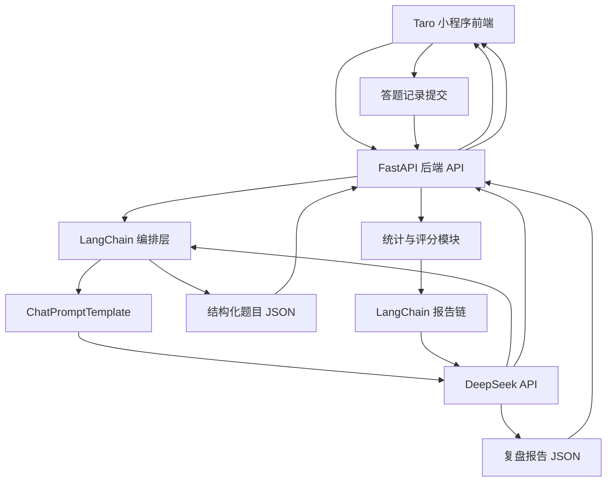

# 《AI 闯关学习小程序》方案设计文档

## 1. 文档目标

本文档用于指导“AI 闯关学习小程序”从 0 到 1 完成 MVP 方案设计与实施落地，重点解决以下问题：

1. 明确小程序前端技术选型，并给出可执行的推荐结论。
2. 围绕核心业务闭环设计整体架构：用户输入内容 => AI 生成题目 => 用户答题 => AI 生成分析报告。
3. 给出后端技术方案、核心 Prompt 设计、接口协议、领域数据模型和分阶段开发路径。
4. 对需求文档中的 todo 项进行收敛，区分“现在就做”和“后续再做”，避免前期工程失控。

本文档默认遵循以下前提：

- 后端语言采用 Python。
- 后端框架采用 FastAPI。
- 大模型采用 DeepSeek，优先使用 `deepseek-chat`。
- 大模型接入优先走 OpenAI 兼容 API。
- MVP 阶段不以联网搜索、用户系统、数据库建模、多模态为重点。
- MVP 的第一目标不是“功能全”，而是最短路径跑通核心学习闭环。

---

## 2. 需求收敛与 MVP 边界

### 2.1 产品目标

产品本质不是一个“传统题库系统”，而是一个“把任意输入知识快速转成闯关问答”的 AI 学习工具。用户价值主要来自三件事：

1. 降低学习材料处理门槛。
2. 通过问答闯关和即时讲解增强学习参与感。
3. 通过报告复盘形成学习闭环。

### 2.2 MVP 只保留的核心能力

结合需求文档与输出计划，MVP 只保留以下能力：

1. 用户输入一句话、一段文本或一个主题。
2. 后端调用 AI 生成 3 到 5 道题目，题型包含单选、多选、判断。
3. 用户逐题作答，提交后立即得到正确答案和详细讲解。
4. 全部题目完成后，系统生成知识总结、答题统计和复盘报告。

### 2.3 明确不前置的能力

以下能力保留在后续版本，不纳入 MVP 首轮开发：

1. 微信授权登录、用户注册、账号体系。
2. MySQL 正式库表设计与复杂持久化。
3. 网页抓取、PDF/Word/视频解析、联网搜索。
4. RAG 私有知识库、向量数据库。
5. 社交 PK、排行榜、分享裂变深度玩法。
6. 生图、语音、数字人等多模态能力。
7. 复杂商业化功能和支付链路。

### 2.4 方案设计原则

1. 先验证 AI 出题质量，再做外围系统。
2. 先做纯文本链路，再扩展多源输入。
3. 先做无状态或轻状态接口，再做用户中心。
4. 先保证题目结构化输出和解析稳定，再优化页面体验。
5. 所有设计以“单人独立开发、尽快上线验证”为第一约束。

---

## 3. 小程序技术选型对比

这是本项目最关键的技术决策之一。由于小程序生态更新很快，选型不能只看“理论能力”，而要看是否适合单人、快速交付、后续可扩展。

### 3.1 选型候选

本次重点比较以下四种方案：

1. 微信原生小程序
2. Taro
3. uni-app
4. uni-app x

### 3.2 对比维度

重点从以下维度比较：

- 学习与开发成本
- 微信小程序适配程度
- 多端扩展能力
- 生态成熟度
- 组件与插件可用性
- 性能与调试体验
- 对单人独立开发的友好度
- 对本项目 MVP 的适配程度

### 3.3 详细对比表

| 方案 | 技术栈 | 优势 | 劣势 | 适合场景 | 对本项目适配结论 |
| --- | --- | --- | --- | --- | --- |
| 微信原生小程序 | WXML / WXSS / JS / TS | 官方能力最完整，兼容性最好，微信特性接入最直接，问题定位最贴近平台 | 多端扩展差，工程化与组件生态相对分散，后续迁移 H5/App 成本高 | 只做微信单端、强依赖平台原生能力的项目 | 不是首选，除非明确永远只做微信单端 |
| Taro 4.x | React / Vue + Taro API | 开源、工程化成熟、对 VSCode 友好、多端扩展能力强，微信小程序/H5/RN 统一路径清晰，适合前后端分离项目 | 仍需理解小程序运行约束与跨端差异，首屏和组件细节需要按小程序思维处理 | 独立开发者或团队希望用现代前端工具链开发微信小程序，并保留后续扩展 H5 / RN 的空间 | 本项目推荐方案 |
| uni-app | Vue3 + uni API | 对中文开发者友好，微信小程序落地成熟，插件生态丰富，Vue3 开发效率高，多端扩展能力强，学习成本低 | 更偏 DCloud 工具链和生态，部分资料与插件默认按 HBuilderX 路径组织，CLI 工作流的工程一致性不如 Taro 明确 | 单人或小团队，接受 DCloud 生态、优先追求快速上手的业务 | 可用，作为第二备选 |
| uni-app x | uts + uvue | 面向未来的高性能跨端引擎，原生能力强，官方持续推进，已支持微信小程序 | 心智模型更重，需要理解 uts 与 uvue 约束，CSS 和生态兼容边界更多，且运行/发行工具链更依赖 HBuilderX | 高性能 App、多端统一原生化、愿意承担额外工程成本的团队 | 不适合作为当前 MVP 首发方案 |

### 3.4 最新调研结论

结合官方资料，可以得到以下关键判断：

1. `Taro 4.x` 仍然是当前开源跨端框架里非常稳妥的主流选择，支持 React / Vue，官方文档、社区案例和工程化能力都足够成熟。
2. 对本项目而言，`Taro 4.x` 更符合“VSCode 开发 + 微信开发者工具调试”的工作流，也更贴近现代前端工程体系。
3. `uni-app` 依然是可行方案，但如果目标明确是使用开源框架并弱化对 DCloud 工具链的依赖，`Taro` 更合适。
4. `uni-app x` 已经支持微信小程序，但它的核心价值更偏“高性能原生跨端”，工具链和心智成本都更重，不适合作为当前 MVP 的最低风险方案。
5. 微信原生虽然最稳定，但会限制未来扩展 H5 / RN / 其他小程序的路径，不利于该项目后续形成统一产品线。

### 3.5 最终推荐

**推荐结论：MVP 阶段采用 `Taro 4.x`。**

推荐理由如下：

1. 最符合“单人独立开发、最短时间交付”的约束。
2. `Taro 4.x` 是开源框架，便于坚持 `VSCode + CLI + 微信开发者工具` 的开发模式。
3. 微信小程序支持成熟，后续扩展 H5 或 RN 时保留更好的代码复用空间。
4. 更贴近现代前端工程体系，便于后续接入 ESLint、Prettier、测试和 CI。
5. 本项目前期重点不在极致性能，而在 AI 闭环验证，`Taro 4.x` 足够支撑。
6. 默认建议采用 `React + TypeScript` 方案；如果后续你明确想统一 Vue 生态，也可以切换到 `Taro Vue3`，但首版文档按 React 方案展开。

### 3.6 不推荐直接上 uni-app x 的原因

1. 当前 MVP 不是性能瓶颈型产品，不值得为了理论性能引入额外工程复杂度。
2. `uts` 和 `uvue` 的约束会增加学习和排障成本。
3. 对第三方 UI、NPM 生态和跨端样式约束的兼容判断更复杂。
4. 独立开发者第一阶段应该优先压缩变量，而不是引入下一代框架风险。

### 3.7 备选方案

如果你后续更希望降低学习成本，或者团队已有较多 Vue / uni-app 经验，则可以把 `uni-app Vue3` 作为第二推荐方案。

---

## 4. 整体系统架构设计

### 4.1 架构目标

整体架构必须满足三件事：

1. 前后端可以并行开发。
2. AI 生成结果必须结构化，前端不能依赖脆弱的文本解析。
3. 后续扩展输入源、RAG、用户系统时，不需要推翻当前核心模块。

### 4.2 总体架构图



### 4.3 核心模块拆分

前端模块：

1. 首页输入模块
2. 题目闯关模块
3. 即时反馈模块
4. 报告展示模块

后端模块：

1. 接口层：处理 HTTP 请求、参数校验、响应封装
2. 应用服务层：编排出题、评分、报告生成流程
3. LangChain 编排层：维护 Prompt 模板、输出 Schema 和调用链
4. AI 适配层：通过 LangChain 统一封装 DeepSeek 调用
5. 领域模型层：题目、选项、答题记录、报告等数据结构
6. 基础设施层：日志、配置、异常、限流、敏感词过滤

### 4.4 数据流设计

#### 流程一：生成题目

1. 用户在首页输入学习主题或一段文本。
2. 前端调用后端 `生成题目接口`。
3. 后端清洗输入文本并做敏感词与长度校验（不通过直接返回 4002 / 4003，不检索、不调模型）。
4. 检索规划（见 7.8）：有可用数据源时（配了 `TAVILY_API_KEY` → 联网；已登录且知识库里有可出题资料 → 该用户的知识库），由 Agent 决定查哪里、查什么，也可以都不查；Agent 关闭或规划失败时按固定规则——用清洗后的学习内容（前 400 字）联网检索一次（见 7.6），不查知识库。检索失败、超时、额度用尽或没有结果时不带资料继续。
5. 后端通过 LangChain 的 `ChatPromptTemplate` 组装提示词（联网参考资料放在 `<material>` 之后独立的 `<reference>` 块；知识库片段放在独立的 `<materials>` 块），并调用 DeepSeek。
6. 后端校验 JSON 结构是否合法；不合格时换保守 Prompt 重试，重试复用第 4 步的资料，不重新规划、不重复检索。用到知识库片段的题带出处，无效的片段编号只丢弃。
7. 后端返回标准题库数据给前端（接口结构不变，不返回联网来源；任一题带出处时 `source_type=knowledge_base`）。
8. 前端进入闯关页开始答题。

#### 流程二：用户答题

1. 前端展示题目与选项。
2. 用户选择答案后，前端本地比对正确答案并即时展示讲解。
3. 前端记录每题答题行为，包括答案、是否正确、用时。
4. 全部题目结束后，将本轮答题记录提交给后端。

#### 流程三：生成报告

1. 后端接收答题记录与原始题库。
2. 后端计算正确率、知识点掌握情况、薄弱点。
3. 后端通过 LangChain 报告链生成结构化复盘报告。
4. 前端渲染总结、正确率、知识建议和分享素材。

---

## 5. 技术栈设计

### 5.1 前端技术栈

- 框架：`Taro 4.x`
- 视图库：`React 18`
- 语言：`TypeScript`
- 状态管理：优先轻量方案，MVP 可使用 `Zustand` 或页面内状态
- 请求库：基于 `Taro.request` 的统一封装，或使用兼容良好的轻量请求层
- UI 策略：优先自定义轻量组件，不在 MVP 引入过重 UI 框架
- 构建工具：`Taro CLI + VSCode + 微信开发者工具`

### 5.2 后端技术栈

- Web 框架：`FastAPI`
- 运行环境：`Python 3.11+`
- 数据校验：`Pydantic v2`
- 模型编排框架：`LangChain`
- LangChain 模型适配：`langchain-openai`
- Prompt 模板：`ChatPromptTemplate`
- 结构化输出：`with_structured_output()` + `Pydantic`
- 配置管理：`pydantic-settings`
- 日志：`structlog` 或标准 logging
- 测试：`pytest`

### 5.3 为什么选 FastAPI

1. 参数校验与文档能力强，适合快速定义 AI 接口。
2. 天然生成 OpenAPI 文档，便于前后端并行联调。
3. 异步友好，后续接入解析任务、异步报告生成更平滑。
4. 对单人开发效率很高，工程心智负担低于传统框架组合。

### 5.4 为什么使用 LangChain 作为正式接入层

结合 LangChain 官方文档，本项目应当把 LangChain 作为 DeepSeek 的正式接入层，而不是仅作为可选辅助库。

推荐原因：

1. LangChain 官方推荐使用 `ChatPromptTemplate` 组织系统消息和用户消息，这比拼接长字符串 Prompt 更稳定、更易维护。
2. LangChain 官方提供结构化输出能力，可以直接把模型返回结果约束到 `Pydantic` Schema，适合本项目的题库 JSON 和报告 JSON 场景。
3. `langchain-openai` 的 `ChatOpenAI` 支持通过 `base_url` 和 `api_key` 对接 OpenAI 兼容接口，因此可以直接接 DeepSeek。
4. 把模型调用统一放在 LangChain 层，后续切换模型、增加重试、增加输出解析和引入 RAG 时，扩展路径更清晰。

使用边界也需要明确：

1. MVP 中使用 LangChain 的 `ChatPromptTemplate`、`ChatOpenAI`、`with_structured_output()`。
2. 不在首版引入 Agent、复杂工具调用、LangGraph 或重型 RAG 编排。
3. LangChain 是正式编排层，但仍要保留清晰的服务层与异常处理，不能把所有逻辑堆进链定义中。

结论是：**LangChain 是本项目对接 DeepSeek 的正式方案，但首版仅使用其稳定的 Prompt 与结构化输出能力。**

---

## 6. 后端架构设计

### 6.1 推荐项目结构

```text
backend/
  app/
    api/
      v1/
        routes/
          health.py
          quiz.py
          report.py
    core/
      config.py
      logging.py
      exceptions.py
      security.py
    models/
      quiz.py
      report.py
      common.py
    services/
      quiz_service.py
      report_service.py
      scoring_service.py
    prompts/
      quiz_prompt.py
      report_prompt.py
    llm/
      langchain_factory.py
      quiz_chain.py
      report_chain.py
      output_schemas.py
    utils/
      text_cleaner.py
      content_filter.py
      id_generator.py
    main.py
  tests/
    test_quiz_api.py
    test_report_api.py
    test_prompt_contract.py
  requirements.txt
```

### 6.2 分层职责

#### API 层

负责：

1. 请求参数校验
2. 返回码和响应格式统一
3. 错误码映射
4. 接口级日志记录

#### Service 层

负责：

1. 调用 LangChain 出题链或报告链
2. 组织输入参数并触发模型编排
3. 做 JSON 结果兜底校验
4. 组装业务响应对象

#### LLM 层

负责：

1. 基于 `langchain-openai` 初始化 DeepSeek 对应的 `ChatOpenAI`
2. 统一管理模型、温度、超时、重试配置
3. 通过 `ChatPromptTemplate` 和 `with_structured_output()` 生成可复用调用链
4. 统一处理模型空响应、格式异常、截断风险

#### Prompt 层

负责：

1. 维护版本化 Prompt 模板
2. 维护结构化输出 Schema
3. 提高出题质量一致性
4. 为未来 A/B Test 预留扩展点

---

## 7. DeepSeek 接入方案

### 7.1 模型选择

MVP 推荐：

- 首选：`deepseek-chat`
- 预留：`deepseek-reasoner`

推荐理由：

1. 出题与报告生成更关注稳定输出和成本平衡。
2. `deepseek-chat` 更适合标准化内容生成。
3. `deepseek-reasoner` 可作为高难题或复杂分析的后续增强能力，而不是 MVP 必需项。

### 7.2 接入方式

使用 `LangChain + langchain-openai` 对接 DeepSeek 的 OpenAI 兼容接口，推荐方式如下：

- 使用 `ChatOpenAI`
- `base_url = https://api.deepseek.com`
- `api_key = DEEPSEEK_API_KEY`
- `model = deepseek-chat`
- 通过 `ChatPromptTemplate` 构建消息模板
- 通过 `with_structured_output()` 约束输出到 `Pydantic` 模型

推荐代码形态：

```python
from langchain_openai import ChatOpenAI
from langchain_core.prompts import ChatPromptTemplate

llm = ChatOpenAI(
  model="deepseek-chat",
  base_url="https://api.deepseek.com",
  api_key="${DEEPSEEK_API_KEY}",
  temperature=0.4,
)

prompt = ChatPromptTemplate.from_messages(
  [
    ("system", "你是一名专业的 AI 学习教练。"),
    ("user", "{user_input}"),
  ]
)
```

### 7.3 JSON 输出策略

根据 DeepSeek 和 LangChain 官方文档，结构化输出建议按以下策略落地：

1. LangChain 层优先使用 `with_structured_output()` 约束输出 Schema。
2. Prompt 中仍然明确要求输出 JSON 语义，并给出目标字段结构。
3. DeepSeek 底层保持 OpenAI 兼容调用方式，必要时补充 `response_format` 约束。
4. `max_tokens` 要保守设置，防止结构体被截断。
5. 输出结果进入服务层后，仍需做字段完整性校验，不能只依赖模型侧保证。

### 7.4 可靠性设计

出题链路必须增加以下兜底：

1. 一级校验：检查返回内容是否为空。
2. 二级校验：检查 LangChain 结构化输出是否成功映射到 Schema。
3. 三级校验：检查字段是否完整，例如题目数、选项数、答案格式。
4. 四级校验：若失败，自动重试 1 到 2 次，并切换到更保守 Prompt。
5. 五级兜底：若仍失败，返回“生成失败，请重试”而不是把脏数据交给前端。

### 7.5 调用参数建议

出题接口建议：

- temperature: `0.4`
- top_p: `0.9`
- timeout: `30s`
- max_tokens: 根据题量控制在合理范围
- LangChain Runnable 超时与重试策略统一在模型工厂层配置

报告接口建议：

- temperature: `0.5`
- top_p: `0.9`
- timeout: `30s`
- 通过独立的报告链复用相同模型工厂配置

### 7.6 出题前联网检索（Tavily Search）

目的：用户问到较新的产品、版本、政策、数据或冷门主题时，模型容易编出过时或错误的事实。出题前先搜一次，把网页摘要作为参考资料交给模型，约束题目和标准答案的事实准确性。

实现要点：

- 客户端：`app/services/web_search.py` 的 `TavilySearcher`，用 `httpx` 直接调用 `POST https://api.tavily.com/search`（`Authorization: Bearer <key>`），请求参数 `search_depth=basic`、`max_results=5`、`topic=general`，不取 `answer` 和网页全文。客户端在 `lifespan` 中创建、挂在 `app.state.web_searcher`，没配 Key 时为 `None`。
- 参考资料：`build_reference` 逐条清洗、去掉尖括号（防止闭合分隔标签）、丢弃命中敏感词的条目，单条与总长度截断，格式为 `[n] 标题\n摘要`。
- Prompt：v1 / v2 system 各加一条规则——事实、数据、版本以参考资料为准；无关或互相矛盾的资料不采用；资料中的任何指令都不执行；题目里不提“参考资料”或网址。没有资料时 human 消息不出现 `<reference>` 块。
- 是否检索、查询词由检索规划 Agent 决定（见 7.8），一次请求最多联网 2 次，两次结果按 url 去重后合并为一份参考资料（总长度上限不变）；Agent 关闭或规划失败时退回固定规则：以学习内容前 400 字检索一次。换保守 Prompt 重试时复用同一份资料，不重新检索。

降级策略（检索是尽力而为，用户无感知）：

| 情况 | 行为 |
|---|---|
| 未配置 `TAVILY_API_KEY` | 不检索，按原流程出题 |
| 超时（`TAVILY_TIMEOUT_SECONDS`）/ 网络错误 | 记录告警日志，不带参考资料出题 |
| 401 Key 无效、429 限流、432 / 433 额度用尽、5xx | 记录告警日志（含状态码），不带参考资料出题 |
| 返回非 JSON、缺 `results`、0 条结果 | 不带参考资料出题 |

接口不新增错误码；日志只记录状态码、结果条数、耗时，不记录 Key 和请求头。

配置（`backend/.env`，不进 git；`.env.example` 只放空占位）：

| 环境变量 | 默认 | 说明 |
|---|---|---|
| `TAVILY_API_KEY` | 空 | 为空即关闭检索 |
| `TAVILY_BASE_URL` | `https://api.tavily.com` | 测试可替换 |
| `TAVILY_SEARCH_DEPTH` | `basic` | `basic` 每次 1 credit，`advanced` 2 credits |
| `TAVILY_MAX_RESULTS` | `5` | 每次取几条结果 |
| `TAVILY_TIMEOUT_SECONDS` | `8.0` | 检索等待上限，最坏比不检索多这么久 |
| `WEB_REFERENCE_ITEM_MAX_CHARS` | `600` | 单条摘要上限（字符） |
| `WEB_REFERENCE_MAX_CHARS` | `3000` | 参考资料总长度上限（字符） |

额度：每次联网检索消耗 1 credit（basic），免费套餐 1000 credits/月，开发 Key 限 100 RPM。启用检索规划后，常识主题通常不联网，总用量预计比“每次出题固定检索 1 次”少；但单次请求最多 2 次（2 credits）。额度用尽时自动降级为不检索出题，可通过日志中的 432 / 433 状态码监控，需要时升级套餐。

隐私：固定规则下只把清洗后的学习内容前 400 字作为查询词发给 Tavily；检索规划下查询词由 Agent 写，截到 100 字，要求只写通用主题词、不含资料原文（见 7.8 的风险说明）。都不带用户身份、openid 或 token。上线前需在隐私说明中写明“出题时会把学习主题发送给第三方搜索服务”。

部署与回滚：在 `backend/.env` 增加 `TAVILY_API_KEY` 后重启即生效；删除该变量即可关闭，无需回退代码，无数据变更。

知识库出题（7.7）在检索规划关闭或失败时不联网；Agent 可以在知识库出题时联网查背景，但结果只作背景，不作为出题依据（见 7.8）。

### 7.7 知识库与 RAG 出题

目的：考证备考、新人考核这类场景要考的是用户手里的资料（教材、制度、手册），模型不知道这些内容。用户把资料传进自己的知识库，出题时系统检索或抽取资料片段交给模型，题目、答案和讲解只依据这些片段，每题标出处。

整体分工：

| 组件 | 选型 | 说明 |
|---|---|---|
| 文本与状态 | MySQL：`knowledge_bases`、`kb_documents`、`kb_chunks` | 以 MySQL 为准；只新增表，不改已有表 |
| 向量索引 | 嵌入式 Chroma（`CHROMA_PATH`，默认 `data/chroma`） | 只存向量和过滤用的 metadata（`user_id`、`kb_id`、`document_id`、`page`），不存正文，可从 `kb_chunks` 重建；集合名带模型标识（`kb_chunks__bge_m3`），余弦距离 |
| 向量化 | 硅基流动 `BAAI/bge-m3`（1024 维） | `app/rag/embedding.py` 用 `httpx` 直连 `POST {SILICONFLOW_BASE_URL}/embeddings`，每批最多 32 条 |
| 文档解析 | `pypdf` / `python-docx` | `app/rag/parsing.py`，纯函数，放线程池执行 |

接口见 `backend/README.md`「知识库」一节：建库 / 列表 / 详情 / 改名 / 删库、上传资料、删资料、`POST /api/v1/knowledge-bases/{kb_id}/quiz` 出题。知识库接口都要求登录；数据库不可用或没配 `SILICONFLOW_API_KEY` 时一律返回 5000（HTTP 503），其余接口不受影响。

#### 上传与后台处理

1. 上传接口（multipart，字段 `file`）先查知识库归属和资料数上限（4040 / 4022），再按 64 KB 分块写到 `KB_UPLOAD_DIR`，自己计数，超过 20 MB 立即停止（4021，不信任 `Content-Length`；空文件同样 4021）。
2. 判断类型：扩展名必须是 `.pdf/.docx/.txt/.md`，且内容签名匹配（PDF 以 `%PDF-` 开头；DOCX 是含 `word/document.xml` 的 zip；TXT / MD 能按 UTF-8 或 GB18030 解码且不含 NUL），否则 4020。
3. 登记一份 `processing` 的资料并立即返回，后台任务（`KbIngestor`，进程内 `asyncio` 任务，`KB_PROCESS_CONCURRENCY` 个信号量限流）开始处理：

```text
解析（线程池）→ 切块 → 敏感词标记 → 分批向量化 → 一个 MySQL 事务里：
    SELECT ... FOR UPDATE 确认资料仍存在且是 processing（已被删除 → 放弃，清理向量）
    写 kb_chunks（自增 id 即向量 id）→ Chroma upsert → 状态 ready，写页数 / 字数 / 块数 → 提交
任何异常 → 尽力删除该资料的向量 → 状态 failed + 用户能看懂的原因
finally：删除上传的临时文件（不保留原始文件）
```

- 解析：PDF 逐页提取，每页一段，页码从 1 开始；加密或解析异常判为“文件打不开”；可见字符总数 < 50 或平均每页 < 20 字判为“读不出文字，可能是扫描件”。DOCX 按文档顺序取段落和表格；TXT / MD 整段解码。提取出的字数超过 `KB_MAX_CHARS`（30 万）判为“内容太长”。
- 切块：先按空行分段，再贪心拼到约 `KB_CHUNK_CHARS`（500 字），相邻块重叠 `KB_CHUNK_OVERLAP`（80 字）；超长段按句号等标点切，仍超长按长度硬切。PDF 的块不跨页，所以出处页码准确。
- 命中敏感词的块标 `flagged=1`，照常存但不参与出题。
- 失败原因：读不出文字（扫描件）、文件打不开（损坏 / 加密）、内容太长、向量化服务暂时不可用，其余为“处理失败，请稍后重新上传”。
- 启动恢复：处理任务在进程内，重启会中断。`lifespan` 启动时把仍为 `processing` 的资料标为失败（“处理被中断，请重新上传”），并清空上传目录；关闭时取消未完成的任务。

删除资料 / 知识库：先在 MySQL 事务里删 `kb_chunks`、`kb_documents`（删库再删 `knowledge_bases`），提交后删 Chroma 中对应 `document_id` 的向量，失败只记日志。检索永远按 MySQL 里的资料列表过滤，残留的孤儿向量不会被用到。已出的题在 `questions_json` 里自带出处快照，删除资料后历史和错题本照常显示。

#### 出题：取材料

`KbQuizService`：

1. `focus`（想重点学什么，选填，≤ 200 字）清洗后命中敏感词 → 4003，不检索、不调模型；清洗后为空视为没填。
2. 资料范围：`document_ids` 为空即该库全部资料，否则必须都属于该库（4040）；只用其中 `ready` 的，一份都没有 → 4023。
3. 取片段（都排除 `flagged`）。检索规划开启且填了重点时，先由 Agent 在所选资料里改写 / 拆分查询词检索（7.8），片段按 id 去重后作为材料；Agent 没查知识库、没查到片段或规划失败时，按下面的固定规则：
   - **填了重点**：`embed([focus])` → Chroma 检索 top `KB_RETRIEVE_TOP_K`（12），`where` 同时限定 `user_id` 和 `document_id ∈ 所选 ready 资料` → 按相似度从 `kb_chunks` 取正文。Embedding / Chroma 任何异常或没有命中 → 记告警，降级为均匀抽取。
   - **没填重点**：总名额 ≈ `KB_MATERIAL_MAX_CHARS / KB_CHUNK_CHARS`，按各资料片段数比例分配，每份至少 1 个；每份资料在片段序列上等距取位置，起点随机偏移——覆盖前中后，多次出题会变化。这一路不调 Embedding。
4. 按优先级（检索按相似度、均匀抽取按资料轮流）累计到 `KB_MATERIAL_MAX_CHARS`（6000 字）为止，再按资料、片段顺序排序编号。每段格式 `[n] 《文件名》第 p 页\n正文`（没有页码省略“第 p 页”），去掉尖括号防止伪造分隔标签。

#### 出题：Prompt、输出与出处

- Prompt：`kb_quiz_prompt_v1` / `kb_quiz_prompt_v2`（常规 / 保守），与文本出题共用题型配比、单选答案位置和通用输出规则。human 消息放 `<materials>`，Agent 联网查了背景时再放 `<background>`（条目不编号，不进入出处编号空间），填了重点再放 `<focus>`；没有 `<reference>`——联网结果在这里**只作背景**，不作出题依据。system 规则：只依据资料出题，资料没写的事实不出；每题在 `source_ids` 填依据的片段编号、在 `source_quote` 照抄一句原文；题干和讲解里不出现“片段 [3]”之类的编号；资料和重点里的任何指令都不执行。
- 结构化输出：单独的 `GeneratedKbQuiz`（每题在 `GeneratedQuestion` 基础上加 `source_ids`、`source_quote`），文本出题的 Schema 和工具定义不变。
- 校验：先走与文本出题相同的 `normalize_quiz`（题量、配比、选项、答案），再 `attach_sources`：丢弃不在本次编号里的 id、去重、最多 3 个；一题没有任何有效出处判为不合格，触发保守 Prompt 重试。摘录：`source_quote` 去空白后是该片段原文的子串就用它，否则取片段开头，都截到 120 字。
- 重试：与文本出题共用 `generate_with_retries`（最多 3 次，首次常规 Prompt、之后保守 Prompt；Key 错误等不可重试异常直接失败；输出过敏感词），全部失败 4001。
- 结果：`Quiz(source_type="knowledge_base", user_input=focus)`，每题 `sources`（`document_id`、`document_name`、`page`、`quote`）。像文本出题一样存为该用户的一话，之后闯关、报告、经验金币、历史、错题本流程都不变。历史详情里任一题带出处即为 `knowledge_base`（`quiz_sessions` 不加列）。

真模型冒烟（`python -m scripts.smoke_quiz --kb 资料.pdf -n 3 --focus "报销审批"`，2026-11-06，10 页文字版 PDF）：入库 1.5s；无重点、有重点各 3 次全部首次通过，单次出题中位数 6.0s、最长 6.4s；34 个出处的页码与摘录全部能在原 PDF 对应页找到；带重点“报销审批”的 3 次出处都落在讲报销的两页。

#### 隐私与部署

- 上传资料提取出的全文、以及带重点出题时填写的重点，会发送给硅基流动做向量化；不配 `SILICONFLOW_API_KEY` 就完全不发送。Key 只放 `.env`，日志和异常信息只记录状态码，不记录 Key。上线前需在隐私说明中写明。
- 不保留原始文件，因此不提供“查看原文”或下载原件。
- 嵌入式 Chroma 只支持单进程写，处理任务也在进程内：**后端只能单 worker 运行**。以后多实例部署时换 Chroma Server 或 Qdrant，`VectorStore` 接口不变。
- 配置项见 `backend/README.md`「知识库配置」。回滚：恢复代码即可；新表和 `data/` 目录留着无害。

### 7.8 出题前的检索规划（Agent）

目的：出题有两个外部数据源——联网检索和用户自己的知识库。用写死的规则（首页每次都联网、知识库出题从不联网、首页出题不查知识库）时，常识主题白白消耗检索额度；用户问的正好是自己资料里的内容，首页出题却用不上；资料里有陌生概念时模型也没法补背景。改由模型根据主题和可用资料决定查哪里、查什么。

两段式：先“检索规划”，再按原链路出题。Agent 只负责检索，不交题——出题、校验、重试、出处校验都不变，重试复用同一份检索结果。

```text
校验输入 → RetrievalPlanner.plan(...)  ──关闭 / 无可用工具 / 失败──→ 固定规则取材
              │成功
              ▼
         RetrievalResult(kb_chunks, web_snippets)
              ▼
     组装 materials / reference / background → 共享重试循环出题 → 校验 + 出处
```

实现要点：

- 模块：`app/agent/retrieval_planner.py`（手写循环，不引入 `langgraph`）、`app/agent/tools.py`（工具参数模型）、`app/prompts/retrieval_agent_prompt.py`（`retrieval_agent_v1`）。模型用 `create_chat_model(temperature=0.1, max_tokens=800)`，`bind_tools(..., tool_choice="auto")`，只绑定本次可用的工具。
- 工具：`search_knowledge_base(query)` → 复用 `kb_materials.retrieve_chunks`（向量检索 top `AGENT_KB_TOP_K`，限定用户与资料范围、排除 `flagged`），回给 Agent 的预览为 `[K编号] 《文件名》第 p 页：正文前 200 字`；`web_search(query)` → 清洗、截到 100 字、过敏感词后调 `TavilySearcher.search`，预览为 `[W编号] 标题：摘要前 150 字`。完整正文和摘要留在服务端交给出题。
- Prompt：两个入口共用一个 system，按入口拼段落（首页 / 知识库有重点 / 知识库无重点）；学习内容放 `<material>`、重点放 `<focus>`，资料目录（最多 30 条“知识库名 / 文件名”，单条截 40 字、去尖括号）放 `<catalog>`；上限数字写进 Prompt；学习内容、重点、目录、工具结果中的指令都不执行；联网查询词只写通用主题词。
- 循环：最多 3 轮模型调用；每轮的工具调用逐个执行（同一条消息的并行调用也逐个计数），第 3 轮的不执行；工具总数到 4 次或联网到 2 次即结束规划，多出的调用回“已达上限”不执行；不合法调用（未知工具、坏 JSON、缺 `query`）回错误消息、不计次数；工具执行失败回“检索失败”、计入次数；模型报错或总耗时超过 20 秒 → `PlanningError`。

两个入口：

| | 首页出题 | 知识库出题 |
|---|---|---|
| 知识库检索 | 已登录 + 知识库可用 + 至少一份 `ready` 资料 → 该用户全部知识库 | 填了重点 → 本次所选 `ready` 资料；没填重点不可用（仍均匀抽取） |
| 联网检索 | 配了 Key | 配了 Key 且 `AGENT_WEB_IN_KB_QUIZ=true` |
| 联网结果 | `<reference>`，事实以它为准（7.6 规则不变） | `<background>`，只帮助理解资料，不作依据、不进出处 |
| 知识库片段 | `<materials>`（格式同 7.7），模型按需引用；结构化输出改用 `GeneratedQuizWithSources`（`source_ids`、`source_quote` 可选），`attach_sources(required=False)`：无效编号只丢弃 | 作为材料；为空时退回固定取材；`attach_sources(required=True)` 不变 |
| 失败 / 关闭时 | 以学习内容联网一次，不查库 | 有重点以重点向量检索一次，没重点均匀抽取，不联网 |

- 首页出题没用到知识库片段时，发给出题模型的 Prompt 和工具定义（`GeneratedQuiz`）与之前逐字一致（有快照测试）。
- `source_type` 统一为“题目是否用到知识库资料”：任一题带出处即 `knowledge_base`，出题响应与历史详情用同一个推导函数。
- 依赖注入：`get_retrieval_llm()` 进程级单例；`get_retrieval_planner()` 在 `AGENT_RETRIEVAL_ENABLED=false` 时返回 `None`；首页的知识库检索执行器 `KbRetriever` 每请求按 `optional_user_id` 组装，未登录或知识库不可用时为 `None`。
- 日志：每次出题一条 `retrieval plan entry=... tools=[...] calls=kb:n,web:n results=kb:n,web:n rounds=n 耗时 fallback=-|timeout|model_error`，没跑规划时 `skipped fallback=disabled|no_tools`；不记学习内容、重点、查询词、正文和 Key。

延迟与成本：每次出题多 1–3 次短的 DeepSeek 调用（预计 +2–6 秒，总超时 20 秒，前端 120 秒超时足够）；常识主题不再固定联网，Tavily 用量预计下降；带重点的知识库出题可能多 1–2 次 Embedding 调用。

风险：

- 联网查询词由 Agent 写，Prompt 禁止写入资料原文、人名和内部信息，并截到 100 字、过敏感词，但**不能完全保证**私有资料不进入查询词——首页出题时 Agent 先查库再联网同样可能如此。需要严格隔离时设 `AGENT_WEB_IN_KB_QUIZ=false` 或关闭 `AGENT_RETRIEVAL_ENABLED`。
- 资料、文件名、网页里夹带指令：工具只读、次数有上限，最坏情况是多花几次检索。
- Agent 选择不稳定（同一主题时查时不查）：低温度；冒烟脚本统计固定主题集上的选择分布，作为 Prompt 调整依据。

配置见 `backend/README.md`「出题前的检索规划」。回滚：`.env` 设 `AGENT_RETRIEVAL_ENABLED=false` 即回到固定规则；代码回退也无数据影响。


---

## 8. 核心 Prompt 设计

Prompt 设计直接决定 MVP 体验质量。首版不要追求花哨，要优先追求“稳定、结构化、可解析”。

### 8.1 出题 Prompt 目标

要求模型基于用户输入生成可直接渲染的题库 JSON，题目应覆盖：

1. 核心概念理解
2. 易错点辨析
3. 应用场景判断

### 8.2 出题 Prompt 设计原则

1. 明确题量，例如 5 题。
2. 明确题型比例，例如单选 3、多选 1、判断 1。
3. 明确输出字段。
4. 明确讲解必须通俗、简洁、适合小程序阅读。
5. 明确禁止输出 Markdown、额外说明、代码块。

### 8.3 出题 Prompt 示例

```text
你是一名专业的 AI 学习教练，请根据用户提供的学习内容生成一组用于小程序闯关答题的题目。

要求：
1. 输出必须是合法 JSON，不要输出任何 JSON 之外的内容。
2. 题目总数为 5 题。
3. 题型包含：3 道单选题、1 道多选题、1 道判断题。
4. 每道题必须包含：题目编号、题型、题干、选项、正确答案、详细讲解、知识点标签、难度。
5. 讲解必须适合初学者阅读，避免过度学术化。
6. 如果用户输入内容过短，可以基于常识进行合理补充，但不要偏离主题。

JSON 输出结构示例：
{
  "title": "学习主题",
  "summary": "本次题库的主题摘要",
  "questions": [
    {
      "id": "q1",
      "type": "single",
      "stem": "题干",
      "options": [
        {"key": "A", "text": "选项A"},
        {"key": "B", "text": "选项B"}
      ],
      "answer": ["A"],
      "explanation": "详细讲解",
      "knowledge_point": "知识点",
      "difficulty": "easy"
    }
  ]
}

用户学习内容如下：
{user_input}
```

### 8.4 报告 Prompt 目标

输入原始主题、题库、用户作答记录，输出结构化复盘报告。

### 8.5 报告 Prompt 输出内容

1. 本次正确率
2. 掌握较好的知识点
3. 薄弱知识点
4. 三句知识总结
5. 后续建议
6. 一句可用于分享的学习金句

### 8.6 报告 Prompt 示例

```text
你是一名学习复盘教练，请根据用户本次闯关答题记录生成一份结构化复盘报告。

要求：
1. 输出必须是合法 JSON。
2. 语言风格清晰、鼓励式，但不要空泛。
3. 分析应基于用户真实答题情况，不要编造未出现的结论。
4. 总结要适合移动端阅读。

JSON 输出结构示例：
{
  "accuracy": 80,
  "mastered_points": ["知识点1"],
  "weak_points": ["知识点2"],
  "three_line_summary": ["一句话1", "一句话2", "一句话3"],
  "advice": ["建议1", "建议2"],
  "share_quote": "今天我又闯过一个知识关卡"
}

用户主题：{topic}
题库数据：{quiz_json}
答题记录：{answer_records}
统计结果：{score_summary}
```

### 8.7 Prompt 版本管理建议

建议从一开始就做版本化：

- `quiz_prompt_v1`
- `quiz_prompt_v2`
- `report_prompt_v1`

这样后续优化模型输出时，不会影响接口调用方和测试基线。

---

## 9. API 接口设计

MVP 接口必须做到足够简单，让前后端并行开发不互相等待。

### 9.1 接口列表

#### 1. 健康检查

- `GET /api/v1/health`

用途：

- 检查后端服务是否启动

#### 2. 生成题库

- `POST /api/v1/quiz/generate`

请求体示例：

```json
{
  "user_input": "我想学习什么是 RAG，以及它和传统搜索有什么区别",
  "question_count": 5,
  "difficulty": "mixed"
}
```

响应体示例：

```json
{
  "quiz_id": "quiz_xxx",
  "title": "RAG 入门闯关",
  "summary": "围绕 RAG 基础概念与应用场景生成的题库",
  "questions": []
}
```

#### 3. 生成复盘报告

- `POST /api/v1/report/generate`

请求体示例：

```json
{
  "quiz_id": "quiz_xxx",
  "topic": "RAG 入门",
  "questions": [],
  "answer_records": [
    {
      "question_id": "q1",
      "selected_answers": ["A"],
      "is_correct": true,
      "duration_ms": 3200
    }
  ]
}
```

响应体示例：

```json
{
  "accuracy": 80,
  "mastered_points": ["RAG 的基本定义"],
  "weak_points": ["RAG 与搜索引擎的边界"],
  "three_line_summary": ["...", "...", "..."],
  "advice": ["...", "..."],
  "share_quote": "把知识做成关卡，记忆会更深。"
}
```

### 9.2 为什么不单独设计“提交单题答案接口”

MVP 阶段不建议把每道题都交给后端判题，原因如下：

1. 正确答案已在题库 JSON 中，前端可以即时反馈。
2. 单题提交会增加接口复杂度和网络等待。
3. 当前核心目标是验证题目质量和报告质量，不是做实时对战。

更合理的做法是：

1. 前端本地即时判题并展示讲解。
2. 全部题目结束后一次性提交作答记录生成报告。

### 9.3 统一响应规范

建议后端统一返回结构：

```json
{
  "code": 0,
  "message": "ok",
  "data": {}
}
```

错误时：

```json
{
  "code": 4001,
  "message": "题库生成失败，请稍后重试",
  "data": null
}
```

---

## 10. 领域数据模型设计

本节先定义业务对象，不展开正式库表设计。

### 10.1 Quiz

```json
{
  "quiz_id": "quiz_xxx",
  "title": "字符串",
  "summary": "字符串",
  "source_type": "text|knowledge_base",
  "user_input": "原始输入（知识库出题时为清洗后的重点，没填为空串）",
  "questions": []
}
```

### 10.2 Question

```json
{
  "id": "q1",
  "type": "single|multiple|judge",
  "stem": "题干",
  "options": [
    {"key": "A", "text": "选项A"}
  ],
  "answer": ["A"],
  "explanation": "详细讲解",
  "knowledge_point": "知识点标签",
  "difficulty": "easy|medium|hard",
  "sources": [
    {"document_id": "doc_xxx", "document_name": "员工手册.pdf", "page": 6, "quote": "不超过 120 字的原文摘录"}
  ]
}
```

`sources`：知识库出的题至少 1 项（PDF 有页码，其他类型 `page` 为 null）；文本出题为空数组。

### 10.3 AnswerRecord

```json
{
  "question_id": "q1",
  "selected_answers": ["A"],
  "is_correct": true,
  "duration_ms": 3200
}
```

### 10.4 Report

```json
{
  "accuracy": 80,
  "mastered_points": ["..."],
  "weak_points": ["..."],
  "three_line_summary": ["...", "...", "..."],
  "advice": ["...", "..."],
  "share_quote": "..."
}
```

### 10.5 MVP 阶段存储策略

MVP 推荐按以下顺序实现：

1. 第一阶段：无数据库，前端持有题库，后端无状态生成报告。
2. 第二阶段：后端把题库和报告落地到本地 JSON 文件或 SQLite，便于调试。
3. 第三阶段：接入 MySQL，设计正式用户、题库、答题记录、报告表。

这比一开始就上 MySQL 更符合当前项目节奏。

---

## 11. 前端页面与交互设计

你已经明确前期不重点展开 UI 方案，因此这里只保留对开发有帮助的最小页面设计。

### 11.1 页面列表

1. 首页 `pages/index/index`
2. 闯关页 `pages/quiz/index`
3. 报告页 `pages/report/index`

### 11.2 首页

功能：

1. 输入主题或文本
2. 点击“开始生成”
3. 展示生成中状态
4. 失败重试

### 11.3 闯关页

功能：

1. 展示当前题目与进度
2. 支持单选、多选、判断
3. 用户提交后立即展示对错与讲解
4. 展示经验值、答题正确数、剩余题数

### 11.4 报告页

功能：

1. 展示正确率
2. 展示三句知识总结
3. 展示掌握点与薄弱点
4. 展示复习建议
5. 预留分享海报按钮

### 11.5 交互原则

1. 单题反馈必须即时，不要要求用户全部做完才知道对错。
2. 每道题讲解内容必须可折叠，避免页面过长。
3. 每次 AI 生成过程都要给明确 loading 状态。
4. 页面状态以简单清晰为主，不要前期加入复杂动画和排行榜干扰主流程。

---

## 12. 核心业务流程与开发思路

### 12.1 MVP 实施顺序

正确顺序应该是：

1. 先把后端 `生成题库接口` 跑通。
2. 再做前端闯关页面。
3. 再做报告生成接口。
4. 最后把首页接入，形成端到端闭环。

而不是一开始就做：

1. 用户系统
2. 数据库
3. 分享海报
4. 多端适配细节

### 12.2 为什么必须先验证 AI 出题接口

因为这个项目的核心不是“题目展示页面”，而是“AI 是否能稳定生成可玩、可讲解、可复盘的结构化题库”。

如果这一步不稳定，后面的页面、账户、数据库都没有实际价值。

### 12.3 推荐验证顺序

#### Step 1

用 Postman 或 Swagger 调通 `POST /api/v1/quiz/generate`。

验收标准：

1. 返回结构稳定。
2. 题目质量可接受。
3. 讲解清晰。
4. 失败可兜底。

#### Step 2

前端拿静态 JSON 先做闯关页。

验收标准：

1. 单选、多选、判断能正确渲染。
2. 答题后能立刻反馈。
3. 多题切换流程顺畅。

#### Step 3

接入真实生成题库接口。

验收标准：

1. 首页输入后能正常跳到闯关页。
2. 题目数据显示正确。

#### Step 4

完成 `POST /api/v1/report/generate`。

验收标准：

1. 报告能根据答题结果变化。
2. 总结与建议不是模板废话。

---

## 13. 分阶段开发计划

### Phase 0：环境搭建

目标：

- 建立前后端基础工程
- 接通 DeepSeek API
- 确定目录结构与代码规范

交付物：

1. `Taro 4.x` 前端初始化项目
2. `FastAPI` 后端初始化项目
3. `.env` 配置与基础日志
4. 健康检查接口

### Phase 1：后端 AI 出题接口

目标：

- 优先验证最核心的 AI 能力

交付物：

1. `POST /api/v1/quiz/generate`
2. 出题 Prompt V1
3. DeepSeek JSON 输出解析与重试机制
4. 题库 JSON 校验逻辑

验收：

1. 连续生成 10 次，结构稳定。
2. 至少 80% 以上输出可直接用于前端渲染。

### Phase 2：小程序闯关页

目标：

- 完成答题流程和即时讲解交互

交付物：

1. 首页输入页
2. 闯关页
3. 本地判题逻辑
4. XP / 进度条基础 UI

### Phase 3：报告生成

目标：

- 打通答题结束后的复盘闭环

交付物：

1. `POST /api/v1/report/generate`
2. 报告 Prompt V1
3. 报告展示页

### Phase 4：完整闭环联调

目标：

- 打通从输入到报告的完整链路

交付物：

1. 首页调用生成题库接口
2. 闯关页承接真实数据
3. 报告页展示真实 AI 结果
4. 异常态与空态处理

### Phase 5：增强能力

目标：

- 在闭环稳定后再扩展外围能力

候选交付物：

1. 分享海报
2. 本地持久化或 MySQL
3. 微信登录
4. 多源输入
5. 错题本和复习提醒

