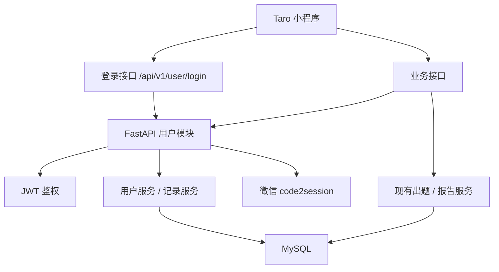

# 《鱼皮 AI 闯关学习小程序》用户系统方案设计文档

## 1. 文档目标

本文档用于指导当前项目在既有 MVP 基础上扩展用户系统，重点解决以下问题：

1. 为小程序接入可用的用户身份体系。
2. 让闯关记录、答题记录、复盘报告可以持久化保存。
3. 让首页和“我的”页面展示真实用户数据，而不是硬编码占位数据。
4. 为后续错题本、复习提醒、排行榜等用户相关功能预留稳定的数据结构。

本文档基于已确认的《用户系统需求分析文档》展开，并明确采用 **MySQL** 作为关系型数据库。

---

## 2. 设计范围

本次方案只覆盖以下内容：

1. 微信静默登录。
2. JWT 鉴权。
3. MySQL 数据持久化。
4. 用户档案接口。
5. 闯关历史列表与详情接口。
6. 前端登录态接入与个人中心展示。

本次不展开：

1. 社交 PK、排行榜。
2. 错题本、艾宾浩斯复习。
3. VIP、支付。
4. 分享海报生成。
5. 多源输入扩展。

---

## 3. 设计原则

1. **尽量少改现有核心链路**：不推翻现有“出题 -> 答题 -> 报告”流程，只在关键节点加用户关联和落库。
2. **先打通身份，再做数据利用**：没有稳定登录态，后续统计和历史记录都不成立。
3. **接口兼容匿名模式**：已有核心功能不应因登录问题完全不可用；用户系统上线后，优先支持“登录即持久化，未登录仍可体验”。
4. **结构简单但可扩展**：当前先满足 MVP 用户系统，表结构和接口命名为后续功能预留空间。
5. **前后端边界清晰**：前端负责登录态保存与展示，后端负责鉴权、持久化、统计聚合。

---

## 4. 总体架构



说明：

1. 前端启动时先走微信登录，拿到 token。
2. 后续业务接口统一带 token。
3. 出题接口和报告接口在保留原有业务逻辑的基础上，补充用户关联和数据持久化。
4. 用户中心、首页历史记录等页面直接读取后端聚合结果。

---

## 5. 后端方案设计

### 5.1 模块划分

建议在现有 FastAPI 结构中新增以下模块：

```text
backend/app/
  api/v1/routes/
    user.py
  core/
    auth.py
    db.py
  models/
    user.py
  services/
    user_service.py
    history_service.py
  repositories/
    user_repository.py
    quiz_repository.py
```

职责划分：

1. `user.py`：登录、获取档案、更新档案、历史列表、历史详情接口。
2. `auth.py`：JWT 生成、解析、鉴权依赖。
3. `db.py`：MySQL 连接池与数据库初始化。
4. `user_service.py`：用户注册、档案查询、档案更新。
5. `history_service.py`：历史记录聚合查询。
6. `repositories/`：封装数据库 CRUD，避免 SQL 散落到 service 层。

### 5.2 数据库选型

本次采用 **MySQL 8.x**。

原因：

1. 关系型数据较多，且表关系明确。
2. 历史记录、统计数据、后续排行榜都依赖良好的查询能力。
3. 比 SQLite 更适合正式业务环境和后续扩展。

推荐接入方式：

1. 驱动：`aiomysql`
2. 连接方式：应用启动时创建连接池，关闭时释放
3. 配置项：`mysql_host`、`mysql_port`、`mysql_user`、`mysql_password`、`mysql_database`

### 5.3 核心表设计

#### users

| 字段 | 类型 | 说明 |
|------|------|------|
| id | bigint | 主键 |
| openid | varchar(64) | 微信 openid，唯一 |
| nickname | varchar(100) | 用户昵称 |
| avatar_url | varchar(500) | 头像地址 |
| total_xp | int | 累计经验值 |
| created_at | datetime | 创建时间 |
| updated_at | datetime | 更新时间 |

#### quiz_sessions

| 字段 | 类型 | 说明 |
|------|------|------|
| id | bigint | 主键 |
| quiz_id | varchar(64) | 业务 quiz_id，唯一 |
| user_id | bigint | 用户 id |
| title | varchar(255) | 题库标题 |
| summary | text | 摘要 |
| user_input | text | 原始输入 |
| questions_json | json | 题目 JSON |
| created_at | datetime | 创建时间 |

#### answer_records

| 字段 | 类型 | 说明 |
|------|------|------|
| id | bigint | 主键 |
| quiz_id | varchar(64) | 关联 quiz_id |
| user_id | bigint | 用户 id |
| records_json | json | 答题记录 |
| total_questions | int | 总题数 |
| correct_count | int | 答对题数 |
| accuracy | decimal(5,2) | 正确率 |
| created_at | datetime | 创建时间 |

#### reports

| 字段 | 类型 | 说明 |
|------|------|------|
| id | bigint | 主键 |
| quiz_id | varchar(64) | 关联 quiz_id |
| user_id | bigint | 用户 id |
| report_json | json | 报告完整内容 |
| created_at | datetime | 创建时间 |

设计说明：

1. 题目、答题记录、报告仍保存完整 JSON，便于快速落地，避免前期过度拆表。
2. 核心统计字段单独冗余存储，便于列表查询和聚合分析。
3. 后续如果要做错题本，再从 `records_json` 和 `questions_json` 中拆分明细表。

### 5.4 鉴权方案

采用 **JWT** 作为会话令牌。

流程：

1. 小程序调用 `wx.login()` 获取 code。
2. 前端将 code 提交给后端 `POST /api/v1/user/login`。
3. 后端请求微信 `jscode2session`，拿到 openid。
4. 如果 openid 不存在，则自动创建用户。
5. 后端生成 JWT，内容至少包含 `user_id`、`openid`、`exp`。
6. 前端保存 token，并在后续请求中放入 `Authorization: Bearer <token>`。

策略：

1. `/api/v1/user/*` 默认要求登录。
2. `/api/v1/quiz/generate` 和 `/api/v1/report/generate` 使用可选鉴权。
3. token 无效时，用户中心接口返回未授权；核心体验接口仍可匿名使用。

### 5.5 接口设计

#### 1. 微信登录

- `POST /api/v1/user/login`

请求：

```json
{
  "code": "wx-login-code"
}
```

响应：

```json
{
  "token": "jwt-token",
  "user": {
    "id": 1,
    "nickname": "学习者",
    "avatar_url": "",
    "total_xp": 0
  }
}
```

#### 2. 获取用户档案

- `GET /api/v1/user/profile`

响应：

```json
{
  "id": 1,
  "nickname": "学习者",
  "avatar_url": "",
  "total_xp": 18,
  "quiz_count": 1,
  "correct_count": 4,
  "average_accuracy": 80
}
```

#### 3. 更新用户档案

- `PUT /api/v1/user/profile`

请求：

```json
{
  "nickname": "鱼皮同学",
  "avatar_url": "https://..."
}
```

#### 4. 获取闯关历史列表

- `GET /api/v1/user/quizzes?page=1&page_size=10`

响应：

```json
{
  "items": [
    {
      "quiz_id": "quiz_xxx",
      "title": "RAG 入门闯关",
      "accuracy": 80,
      "question_count": 5,
      "created_at": "2026-04-08 10:00:00"
    }
  ],
  "total": 1,
  "page": 1,
  "page_size": 10
}
```

#### 5. 获取闯关详情

- `GET /api/v1/user/quizzes/{quiz_id}`

响应包含：

1. quiz 基本信息
2. 完整 questions
3. answer_records
4. report

### 5.6 现有接口改造

#### 出题接口

`POST /api/v1/quiz/generate`

改造点：

1. 保持原有入参和返回结构不变。
2. 增加可选用户上下文解析。
3. 有登录态时，将题库写入 `quiz_sessions`。

#### 报告接口

`POST /api/v1/report/generate`

改造点：

1. 保持原有 AI 报告生成逻辑不变。
2. 有登录态时，将答题记录写入 `answer_records`，报告写入 `reports`。
3. 根据规则累加 `users.total_xp`。

---

## 6. 前端方案设计

### 6.1 登录态接入

1. App 启动时检查本地是否已有 token。
2. 无 token 时调用 `Taro.login()`。
3. 拿到 code 后调用后端登录接口。
4. 将 token 和基础用户信息写入本地缓存。

### 6.2 API 层改造

当前 `request()` 统一封装已经存在，可直接扩展：

1. 请求前自动读取 token。
2. 如果存在 token，则附加 Authorization header。
3. 401 时清空 token，并引导重新登录。

### 6.3 页面改造范围

#### 首页

只改这两部分：

1. 顶部问候语改为真实昵称。
2. 经验值改为真实总 XP。
3. “已完成关卡”区域改为真实历史记录。

#### 个人中心页

替换当前占位实现：

1. 头像、昵称、标语展示真实数据。
2. 统计卡展示闯关次数、答对题数、平均正确率。
3. 底部增加历史记录列表。

#### 报告页

不改 UI 主体，只增加一个能力：

1. 当通过历史记录进入时，可直接读取后端详情数据进行展示。

---

## 7. 开发顺序建议

1. 先接 MySQL 和 JWT。
2. 再完成登录接口和用户档案接口。
3. 然后改造出题/报告接口接入持久化。
4. 最后做个人中心和历史记录页面。

原因：

1. 没有身份体系，数据无法归属。
2. 没有持久化，历史列表没有数据来源。
3. 先把后端打通，再做前端展示，联调成本更低。

---

## 8. 风险与约束

1. **微信登录依赖真实小程序配置**：开发时需要有效的 AppID 和 Secret。
2. **本地联调需要 MySQL 环境**：需要准备数据库实例、账号、库名。
3. **历史详情需要兼容旧数据**：如果某些旧闯关记录没有持久化，前端需要允许空态展示。
4. **当前项目仍以快速落地为主**：前期不引入 ORM，优先直接写清晰的 SQL 和 repository 层封装。

---

## 9. 结论

本次用户系统方案采用 **Taro + FastAPI + MySQL + JWT + 微信登录** 的组合，在尽量少改现有核心业务链路的前提下，为项目补齐以下基础能力：

1. 用户身份识别
2. 闯关数据持久化
3. 首页和个人中心真实数据展示
4. 历史闯关记录回看

该方案足够简单，适合当前项目节奏；同时也为后续错题本、复习计划、排行榜等功能保留了扩展空间。

---

## 10. 实施记录（2026-11-05 确认的调整）

开发前对照现有代码和原型逐条确认，以下与第 2–6 节不同之处以本节为准：

| 项 | 原方案 / 需求 | 实际实现 | 原因 |
|----|---------------|----------|------|
| 首页 | 显示昵称、真实 XP、“已完成关卡”真实记录 | 只把等级、经验、金币改为后端数据；不加昵称，不做“已完成关卡”（4.4） | 现有首页与原型都没有这两块，历史记录走“我的 → 历史记录” |
| 个人中心 | 改造“我的”空壳页 | 新建 `pages/me`（原型 03 第 1 屏）+ 自定义 tabBar（闯关 / 复习 / 我的），复习先用空状态占位 | 项目里原本没有“我的”页和 tabBar |
| “我的”列表 | — | 六个入口照原型保留，除“历史记录”外置灰，点了提示“即将上线” | 其余功能不在本期范围 |
| 统计三格 | 闯关次数 / 答对题数 / 平均正确率 | 按原型：已学话数 / 本周分钟 / 总正确率（接口两套都返回） | 以原型为准 |
| 历史列表 | 个人中心底部 | 独立页 `pages/history`（原型 03 第 4、6 屏）；“没答完”只含本机可续答的会话 | 以原型为准；服务端不知道答到第几格 |
| 经验规则 | 完成 +10、每答对 +2 | 每答对 +10 经验、+5 金币；`users` 增加 `total_coins` | 与已上线的前端、原型保持一致 |
| 登录 | — | 静默登录，本期不做原型 01 第 1 屏的登录页 | 按需求文档；登录页需要协议正文 |
| 昵称头像 | 允许更新昵称和头像 URL | 只做改昵称（`type="nickname"` 输入框）；头像显示昵称首字；`avatar_url` 字段与接口保留 | 微信已不返回真实头像昵称；头像上传需额外存储 |
| 数据库 | MySQL 8.x | Docker 里的 MySQL 8.4，端口 3307（本机 3306 被 5.7 占用） | — |
| 落库时机 | 报告接口落库 | 仍在报告接口，但**先**写答题记录并结算经验、**再**调 AI；前端在结算页就发起报告请求 | 用户可能不看报告直接回首页；AI 失败时成绩和经验也不能丢 |
| 防篡改 | — | 登录用户提交报告时，用库里存的题目判题；题库不属于本人则不落库 | 客户端可以改题目答案 |

表结构相对 5.3 节的补充：`quiz_sessions` 增加 `difficulty`、`question_count`；`answer_records` 增加 `total_duration_ms`、`xp_gained`、`coins_gained`，并对 `(user_id, quiz_id)` 建唯一索引（结算幂等）；`reports` 同样 `(user_id, quiz_id)` 唯一。完整 DDL 见 `backend/app/resources/schema.sql`。

新增错误码：4010 未登录（HTTP 401）、4011 微信登录失败、4012 昵称不合规、4040 记录不存在。历史详情额外返回 `episode`（第几话，供海报使用）。

---

## 11. 错题本（2026-11-06，OpenSpec 变更 `add-mistake-review`）

复习标签页改为错题本：列出已完结的话里服务端判为答错（含未作答）、还没掌握的题；重做答对即视为掌握并移出列表。重做**不发**经验和金币，也不改答题记录、正确率和报告。

与 5.3 节设计说明第 3 条不同：错题**不拆明细表**，每次从 `answer_records.records_json` + `quiz_sessions.questions_json` 推导，历史错题无需迁移；新表 `review_items` 只存重做状态，且只在第一次重做某道题时写入。

#### review_items

| 字段 | 类型 | 说明 |
|------|------|------|
| id | bigint | 主键 |
| user_id | bigint | 用户 id |
| quiz_id | varchar(64) | 所属话 |
| question_id | varchar(64) | 题目 id（如 `q1`，只在一话内唯一） |
| wrong_retries | int | 重做时又答错的次数 |
| last_selected_json | json | 最近一次重做答错时的选项，没重做答错过为 null |
| mastered_at | datetime(3) | 重做答对的时间，非空即已掌握 |
| created_at / updated_at | datetime(3) | 创建 / 更新时间 |

`(user_id, quiz_id, question_id)` 唯一。列表中每道错题的答错次数 = 1（闯关那次）+ `wrong_retries`；上次的错误答案优先取 `last_selected_json`，否则取闯关时的选项。

#### 6. 获取错题列表

- `GET /api/v1/review/mistakes`（需登录；无库时 HTTP 503）

按话的完结时间从新到旧，同一话内按题目原顺序。`question` 是完整题目（含答案与讲解），前端重做时本地判题播动画，是否掌握以服务端为准。

响应 `data`：

```json
{
  "items": [
    {
      "quiz_id": "quiz_xxx",
      "quiz_title": "RAG 入门",
      "question": {
        "id": "q4",
        "type": "multiple",
        "stem": "下面哪些是 RAG 的优势？",
        "options": [{"key": "A", "text": "能用上最新的外部资料"}, {"key": "B", "text": "回答从此完全不会出错"}, {"key": "C", "text": "回答可以追溯到出处"}, {"key": "D", "text": "不需要准备任何资料"}],
        "answer": ["A", "C"],
        "explanation": "B 错在“完全”。",
        "knowledge_point": "RAG 的优势与边界",
        "difficulty": "medium"
      },
      "last_selected_answers": ["B", "C"],
      "wrong_count": 1,
      "first_wrong_at": "2026-11-06T02:03:04Z"
    }
  ],
  "total": 1
}
```

#### 7. 提交重做答案

- `POST /api/v1/review/answer`（需登录；无库时 HTTP 503）

请求：

```json
{
  "quiz_id": "quiz_xxx",
  "question_id": "q4",
  "selected_answers": ["A", "C"]
}
```

响应 `data`：

```json
{
  "is_correct": true,
  "correct_answers": ["A", "C"],
  "mastered": true
}
```

规则：

1. 用服务端存档的题目判题，规则与闯关一致（`scoring_service.is_answer_correct`：去空格、不区分大小写、去重后与答案完全相同才算对，空选择算错）；请求里附带的其它字段一律忽略。
2. 答对：记 `mastered_at`，`mastered` 为 true，之后的列表不再返回该题。
3. 答错：`wrong_retries + 1`，`last_selected_json` 更新为本次选项，`mastered` 为 false。
4. 已掌握的题再次提交（如网络重试）：照常返回判题结果，`mastered` 仍为 true，不改任何状态。
5. 题目不是当前用户的错题（话不存在、属于别人、未完结、题号不存在、闯关时就答对了）：返回 code 4040“没找到这道错题”，不写 `review_items`。

---

## 12. 学习数据、知识树与错题本入口（2026-11-07）

“我的”页的“学习数据”“知识树”“错题本”三个入口上线（原型 03 第 1–3 屏）。只有“会员”仍置灰。

### 12.1 出题时归主题

文本出题和知识库出题的 AI 输出多一个 `topic`：2–6 字的大类。提示词让模型先从固定词表里选（AI 技术、编程、理财、职场、健康、生活常识、科学、历史、语言、心理、艺术），都不合适时再自拟。服务端清洗时会去空白和引号、截到 8 字，空则记“其他”。**主题从不触发出题重试。** 出题接口与历史详情的 `quiz` 都多了 `topic` 字段。

`quiz_sessions` 新增一列：

| 字段 | 类型 | 说明 |
|------|------|------|
| topic | varchar(16) | 大类主题，默认空串；空串在知识树里归入“其他” |

旧库靠 `CREATE TABLE IF NOT EXISTS` 不会加列。服务启动时由 `core/db.ensure_columns` 查 `information_schema.COLUMNS`，缺列才执行 `ALTER TABLE`，幂等，也不改已有数据。

### 12.2 用户资料新增字段

`GET /api/v1/user/profile` 只增不改：

| 字段 | 说明 |
|------|------|
| mistake_count | 未掌握的错题数，与 `GET /review/mistakes` 的 `total` 同一口径（`review_service.count_mistakes`），用作错题本入口的红色数字 |
| topic_count | 已完结的话涉及几个主题，空主题合并算一个“其他”，用作知识树入口的“N 个主题” |

错题本入口点击后 `switchTab` 到复习标签（现有的错题本），不另做页面。

### 12.3 学习数据

- `GET /api/v1/user/stats?range=week|month|all`（需登录；无库时 HTTP 503；`range` 不合法返回 4000）

时间段按北京时间计算：本周从周一 0 点起，本月从 1 日 0 点起。只统计已完结的话，按完结时间（`answer_records.created_at`）归入时间段。柱状图分桶如下：本周 7 天，本月按 1–7、8–14… 日每 7 天一格，全部为最近 6 个月每月一格。`week` 和 `month` 同时返回上一周期的分钟数，`all` 的 `prev_minutes` 为 null。

响应 `data`：

```json
{
  "range": "week",
  "period_label": "11 月 2 日 – 8 日",
  "total_minutes": 46,
  "prev_minutes": 34,
  "bars": [{"label": "一", "minutes": 8, "is_current": false}, {"label": "今天", "minutes": 7, "is_current": true}],
  "quiz_count": 6,
  "question_count": 41,
  "type_accuracy": [
    {"type": "single", "correct": 18, "total": 21, "accuracy": 86},
    {"type": "multiple", "correct": 5, "total": 10, "accuracy": 50},
    {"type": "judge", "correct": 8, "total": 10, "accuracy": 80}
  ],
  "multiple_missed": 4,
  "weak_points": ["申购费率", "复利周期"]
}
```

`multiple_missed` 是多选题答错、且所选都是正确选项只是没选全（漏选）的次数。`weak_points` 是正确率最低的最多 3 个有答错的知识点。这两项主要喂给下面的 AI 结论。统计逻辑都在 `services/stats_service.py` 的纯函数里，单测在 `tests/test_stats_service.py`。

### 12.4 AI 学习结论

- `GET /api/v1/user/stats/insight?range=…`（需登录）→ `{"insight": "多选题 10 题错 5 题，4 次是漏选……"}`

结论单独成一个接口，前端先画图，再等这一句。

1. 时间段内没有题：返回 `{"insight": null}`，不调 AI。
2. 指纹 `sha1(range + 喂给模型的统计内容)` 与缓存相同时直接返回缓存。新完结一话、进入新的一周或一月，指纹都会变。
3. 否则调用 `llm/insight_chain.py`（提示词在 `prompts/insight_prompt.py`，只给确定性数字）。结果清洗后截到 80 字，过敏感词后写缓存。生成失败、为空或命中敏感词时返回 null，也不写缓存，下次再试。
4. LLM 调用不在数据库事务里。

#### stats_insights

| 字段 | 类型 | 说明 |
|------|------|------|
| id | bigint | 主键 |
| user_id | bigint | 用户 id |
| range_key | varchar(8) | week / month / all |
| data_hash | char(40) | 统计内容指纹 |
| insight | varchar(255) | 结论 |
| updated_at | datetime(3) | 更新时间 |

`(user_id, range_key)` 唯一，每人每档只存一条。

### 12.5 知识树

- `GET /api/v1/user/knowledge-tree`（需登录）

```json
{
  "topic_count": 2,
  "topics": [
    {
      "topic": "理财", "quiz_count": 2, "correct": 7, "total": 10, "accuracy": 70,
      "quizzes": [
        {"quiz_id": "quiz_xxx", "title": "基金定投", "user_input": "基金定投怎么算手续费",
         "correct": 2, "total": 5, "accuracy": 40, "weak_points": ["申购费率"], "finished_at": "2026-11-06T02:03:04Z"}
      ]
    },
    {"topic": "其他", "quiz_count": 1, "correct": 5, "total": 5, "accuracy": 100, "quizzes": []}
  ]
}
```

主题按最近一次完结时间从新到旧排，“其他”永远在最后；主题内的话也按完结时间新到旧。正确率按题数汇总。前端按 ≥80 绿、60–79 黄、<60 红着色：点一话打开当时的复盘报告；红色的话有“再闯一轮”，用“标题：重点练 答错的知识点”作为输入走首页的出题流程。
